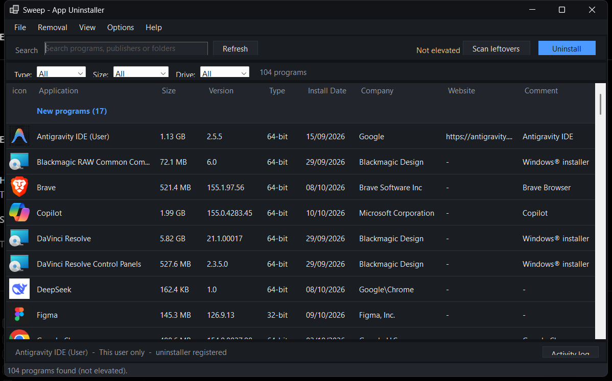
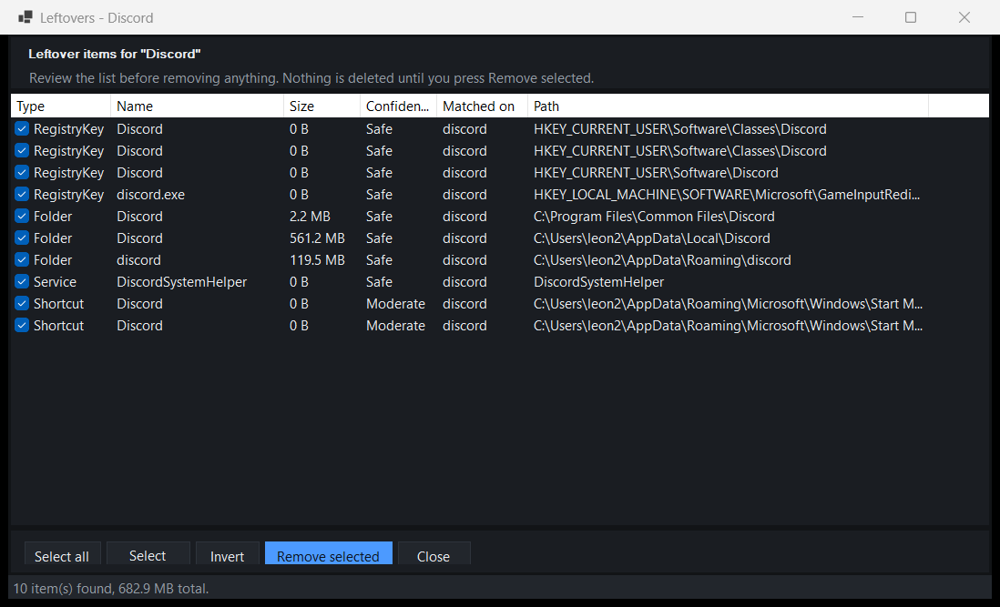

# Sweep — App Uninstaller

A Windows uninstaller that lists installed programs, runs their registered uninstaller,
then finds and removes what was left behind.

Written from scratch against public Windows APIs. No third-party uninstaller engine, no
cloud database, no telemetry.



---

## Install

### Option 1 — download the ARM64 build (recommended on a Snapdragon PC)

1. Download the `Sweep-win-arm64` archive from the Releases page.
2. Extract it anywhere, e.g. `C:\Tools\Sweep`.
3. Run `Sweep.exe`.
4. Accept the UAC prompt. Administrator rights are needed to read `HKLM` and to delete
   from `Program Files`. Without them the app still runs, but machine-wide removals will
   fail — the status bar always shows whether you are elevated.

There is **no installer and nothing is written to `Program Files`**. It is a portable
folder: delete it and the app is gone. Your settings and logs live separately in
`%APPDATA%\Sweep`.

### Option 2 — build it yourself

```powershell
git clone https://github.com/Code-with-L/Sweep.git
cd Sweep

# Self-contained ARM64, no runtime needed on the target machine (~122 MB)
dotnet publish -c Release -r win-arm64 --self-contained true -o dist\win-arm64

# Framework-dependent builds (need .NET 10 Desktop Runtime, ~0.4 MB)
dotnet publish -c Release -r win-x64 --self-contained false -o dist\win-x64
dotnet publish -c Release -r win-x86 --self-contained false -o dist\win-x86
```

Requires the .NET 10 SDK to build.

---

## Which build do I want?

| Target | Build | Size | Needs .NET runtime? |
|---|---|---|---|
| `win-arm64` | self-contained, native ARM64 | ~122 MB | No |
| `win-x64` | framework-dependent | ~0.4 MB | Yes |
| `win-x86` | framework-dependent | ~0.3 MB | Yes |

**Check your architecture:** Settings → System → About → System type.
`ARM-based PC` means use `win-arm64`. `64-bit x64-based PC` means `win-x64`.

All three run on Windows on ARM. `win-x64` runs there under emulation, but the native
`win-arm64` build is what you want on a Snapdragon machine.

---

## Configuration

Settings live in `%APPDATA%\Sweep\settings.json` and are editable in the app under
**Options → Settings**. **Options → Export/Import all settings** round-trips them.

| Setting | Default | What it does |
|---|---|---|
| `SilentUninstall` | `true` | Use the vendor's quiet switches where known |
| `CreateRestorePoint` | `true` | Make a restore point before each removal |
| `UseQuarantine` | `true` | Move leftovers aside instead of deleting, so they can be undone |
| `ScanRegistry` | `true` | Include registry keys and values in the leftover scan |
| `UsePublisherTokens` | `false` | Also match publisher names. Finds more, false-positives more |
| `FileScanDepth` | `3` | Folder levels below each scan root |
| `FileScanSeconds` | `120` | Time budget for the file phase |
| `MaxFileMatches` | `2000` | Caps file results |
| `RegistryScanDepth` | `3` | Registry levels below each root |
| `MaxRegistryMatches` | `300` | Caps registry results |
| `Theme` | `Dark` | `Dark` or `Light` |

**Logs** go to `%APPDATA%\Sweep\logs\sweep-yyyyMMdd.log` and are browsable from
**Options → Open data folder**.

**Quarantine** is `%ProgramData%\Sweep\Quarantine\<app>_<timestamp>_<id>`, or under
`%LOCALAPPDATA%` when that is not writable. Every quarantine session writes a
`manifest.json`; if it cannot be written the app says so loudly, because without it the
items cannot be restored.

---

## How it was built

Plain C# and WinForms — no framework, no third-party packages. `System.Text.Json` is the
only non-BCL dependency and it ships with the runtime.

```
Program.cs           entry point, UAC self-elevation, diagnostic switches
MainForm.cs          program list, filters, sorting, context menu, uninstall flow
ResidueForm.cs       the leftover review pane
AutorunForm.cs       startup entries / services / scheduled tasks
WindowsAppsForm.cs   Store / MSIX apps

RegistryScanner.cs   reads the uninstall registry keys in both WOW64 views
ResidueScanner.cs    the leftover sweep: files, registry, and pruning
SystemArtifacts.cs   value-based scans: startup, services, tasks, shortcuts, fonts, env
Safety.cs            the deny-lists that stop a bad match becoming a broken machine
NameTokens.cs        product name -> conservative search tokens
IconProvider.cs      icon extraction, off the UI thread
PeHeader.cs          reads the real 32/64-bit architecture from the PE header
CommandLine.cs       parses the malformed uninstall strings the registry contains
ProcessHunter.cs     finds and stops an app's running processes
ServiceOps.cs        service start-type via the Service Control Manager
Removal.cs           one dispatch point for every kind of deletion
Audit.cs             --audit: verifies each subsystem on the real machine
```

### Decisions worth explaining

**It was built by measurement, not by inspection.** Every scanner has a headless mode
(`--selftest`, `--audit`) so its behaviour could be checked against the 100+ real
uninstall strings on a test machine rather than reasoned about. That is how the malformed
uninstall commands, the silent-switch duplication bugs and the empty-token bug were all
found — none of them were visible by reading the code.

**Registry views are explicit.** `RegistryView.Registry64` / `Registry32` are passed to
every registry call rather than relying on process bitness, because that is what makes the
app correct under WOW64 *and* on Windows on ARM. x86 program directories come from
`SHGetKnownFolderPath`, the API that behaves correctly under ARM64 emulation.

**Precision was chosen over recall.** A leftover scanner that suggests deleting unrelated
files is worse than no scanner, because the user stops trusting it. Category nouns are
stripped from product names, matching is whole-word/camelCase before substring, the user
profile root is never scanned, and protected directories are refused outright. `VLC media
player` searches for `vlc`, never for `media` — otherwise `Windows Media Player` and
`social-media` come back as VLC leftovers.

**Deleting is reversible by default.** Leftovers go to a quarantine folder with an undo
manifest. Permanent delete and reboot-pending deletes are available but are not the
default.

**Services are changed through the Service Control Manager.** Editing `Start` in the
registry looks like it works and then silently reverts, because SCM caches start types.

---

## Checking it works on your machine

```powershell
# Full self-audit: permissions, coverage, timings, memory, guardrails
Sweep.exe --audit

# Enumerate uninstall plans without ever executing one
Sweep.exe --selftest --dump-uninstallers

# Show the derived search tokens for every installed program
Sweep.exe --selftest --tokens

# Module inventories
Sweep.exe --selftest --storeapps
Sweep.exe --selftest --autorun

# Dry-run a leftover scan for one program
Sweep.exe --selftest --app Discord
```

`--audit` exits `0` when clean and `2` when it found problems, so it can gate a script.

---

## What it does

- **Lists installed programs** from the uninstall registry keys: name, version, publisher,
  install date, size, scope, real 32/64-bit architecture (read from the PE header),
  website and comment.
- **Runs the real uninstaller**, detecting Inno Setup, NSIS, InstallShield, Windows
  Installer, Squirrel and InstallAware, and applying the documented silent switches.
- **Always offers a leftover scan afterwards**, whatever exit code came back, and surfaces
  the uninstaller's own output.
- **Scans for leftovers** across files, folders, the registry, and artefacts a name-based
  sweep cannot reach:

  | Category | Source |
  |---|---|
  | Startup entries | `HKCU`/`HKLM` `…\CurrentVersion\Run`, `RunOnce`, Startup folder |
  | Services | `HKLM\SYSTEM\CurrentControlSet\Services\*` `ImagePath`, with orphan detection |
  | Scheduled tasks | Task Scheduler inventory via `schtasks`, skipping `\Microsoft\Windows\*` |
  | Shortcuts | Start Menu and Desktop `.lnk` files |
  | Environment variables | by variable **name** only |
  | Fonts | `…\CurrentVersion\Fonts` in both hives |
  | File associations | `HKCU\Software\Classes` default values |
  | Registry keys | `HKCU\Software`, `HKLM\SOFTWARE` in both WOW64 views |

- **Rates every match** Safe / Moderate / Risky. Risky items start unchecked.
- **Lists Store/MSIX apps**, which never appear in the uninstall registry keys.
- **Manages startup entries**: disable services and tasks reversibly, open locations.
- **Filters and sorts** by type, size, drive, and any column.
- **Kills an app's running processes** before and after uninstall, matched by install
  folder rather than file name.
- **Quarantines instead of deleting** by default.



---

## Safety

This app deletes things. Three layers stop a bad match becoming a broken machine.

1. **Token discipline.** Category nouns are stripped (`VLC media player` → `vlc`),
   short tokens only match whole words, and publisher matching is off by default.
2. **Refuse-list.** Everything under a system root — `C:\Windows`, `System32`,
   `AppData\Local\Packages`, `ProgramData\Microsoft`, the MSI repair cache, your profile
   root — is never offered. `Program Files` and `ProgramData` are refused only *as roots*,
   because deleting `Program Files\<app>` is the job.
3. **Confirmation and undo.** Everything removable goes to a review list with confidence
   ratings; removal is confirmed once; quarantine is the default.

Additional limits, all deliberate:

- `PATH` *contents* are never edited automatically — only variable names are matched.
- `HKLM\SOFTWARE\Microsoft`, `CLSID`, `TypeLib` and `Installer` are never removed.
- Scheduled tasks under `\Microsoft\Windows\` are never listed, let alone removed.
- A restore point is offered before each removal.

---

## Limitations

- **No per-vendor removal recipe database.** Detection is generic and name-based. It finds
  the common cases but cannot know an application's bespoke quirks. Uninstall history is
  recorded locally in the activity log; there is no shared cloud log service.
- **Registry matching is name-based**, so a third-party key containing the product name can
  be reported. That is why results are reviewed rather than deleted blindly.
- **Browser extensions, add-ons and BHOs are not enumerated.** Reading a browser's
  extension and preference stores safely needs per-profile parsing, and a mistake there
  breaks the user's browser rather than leaving junk behind.
- **MSI component/orphan analysis is not done.** `Win32_Product`-style queries trigger
  self-repair on every package they touch.
- **Startup entries cannot be disabled**, only removed. Windows offers no supported
  "disabled" state for `Run` keys short of the undocumented `StartupApproved` blob, so the
  app says so instead of faking it. Services and tasks disable properly.
- **The light theme keeps a dark title bar** on Windows 11 builds that accept
  `DWMWA_CAPTION_COLOR` and then ignore it. Rounded corners and the dark theme's title
  bar work correctly.
- Store app removal needs PowerShell; a locked-down machine without it cannot uninstall
  MSIX packages from here.
- Quarantined items are moved, so restoring does not restore timestamps or ACLs exactly.

---

## Licence

MIT.